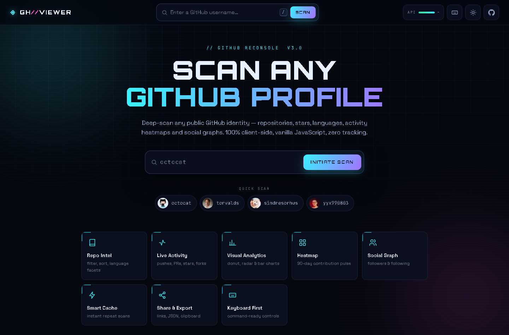
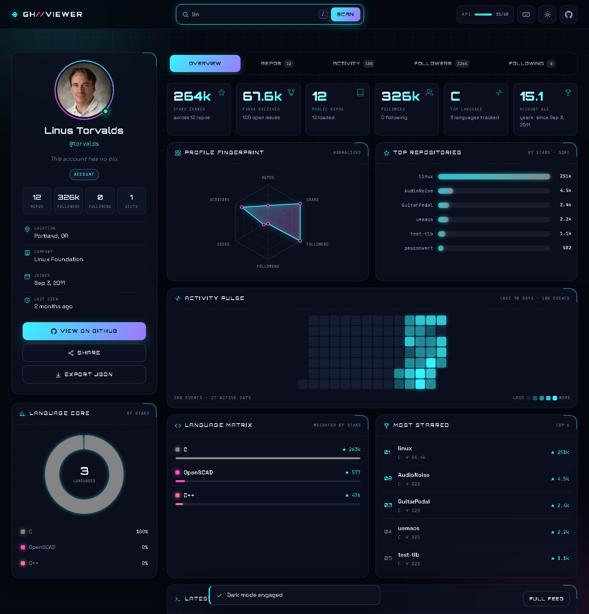

# GH//VIEWER

> A futuristic, fully client-side **GitHub profile viewer** — vanilla JavaScript, zero
> dependencies, zero build step. Deep-scan any public GitHub identity: repositories,
> stars, languages, activity heatmaps and social graphs.



## Features

- **Instant scan** — live user search with type-ahead suggestions, recent scans, quick-scan presets
- **Profile recon card** — avatar ring, stats, location/company/join date, share + export JSON
- **Repository intel** — full repo list with text filter, language facets and sorting
- **Activity feed** — grouped by day (Today / Yesterday / N days ago), typed event icons
- **Social graph** — followers & following, loaded lazily as you browse
- **Visual analytics** — language donut, normalized radar, top-repos bar chart (sqrt-scaled)
- **90-day heatmap** — contribution pulse with intensity legend
- **Live API quota meter** — unauthenticated rate-limit tracking per resource (core vs search)
- **Dark / light themes**, hash-based shareable URLs (`#username`), keyboard shortcuts
- **Mobile-first responsive** — verified from 320 px to 1440 px+, no horizontal overflow
- **Graceful degradation** — empty states, offline/error toasts with auto-retry countdown



## Quick start

No install, no build. Either:

1. **Double-click `index.html`** — it works straight from `file://`, or
2. Serve it statically, e.g. `npx serve .` / `python -m http.server`, then open the printed URL.

Search any GitHub username (try `torvalds`, `octocat`, `sindresorhus`) and hit **SCAN**.

## Project structure

```
index.html          app shell (loads classic scripts in order, no modules/bundler)
css/styles.css      design system, glass surfaces, themes, responsive rules
js/utils.js         event bus, formatting, storage, toasts, icon sprite
js/api.js           fetch + TTL cache + per-resource quota + error taxonomy
js/charts.js        donut / radar / bar charts (DPR-aware, theme-aware redraw)
js/render.js        stats + all panel renderers (overview, repos, activity, people)
js/app.js           state, hash router, tabs, shortcuts, keyboard UX
```

## API notes

Uses the **GitHub REST API unauthenticated** — 60 requests/hour core quota, plus a
separate 10/min search quota. Responses are cached in-memory with a TTL and requests are
deduplicated, so browsing stays comfortably inside the limit. The header quota meter shows
what is left in the current window.

## Keyboard

| Key | Action |
| --- | ------ |
| `/` | Focus search |
| `1`–`5` | Switch tab |
| `T` | Toggle theme |
| `Esc` | Close overlay |
| `?` | Shortcut panel |

---

Built with vanilla HTML/CSS/JS — no frameworks, no dependencies, no telemetry.
